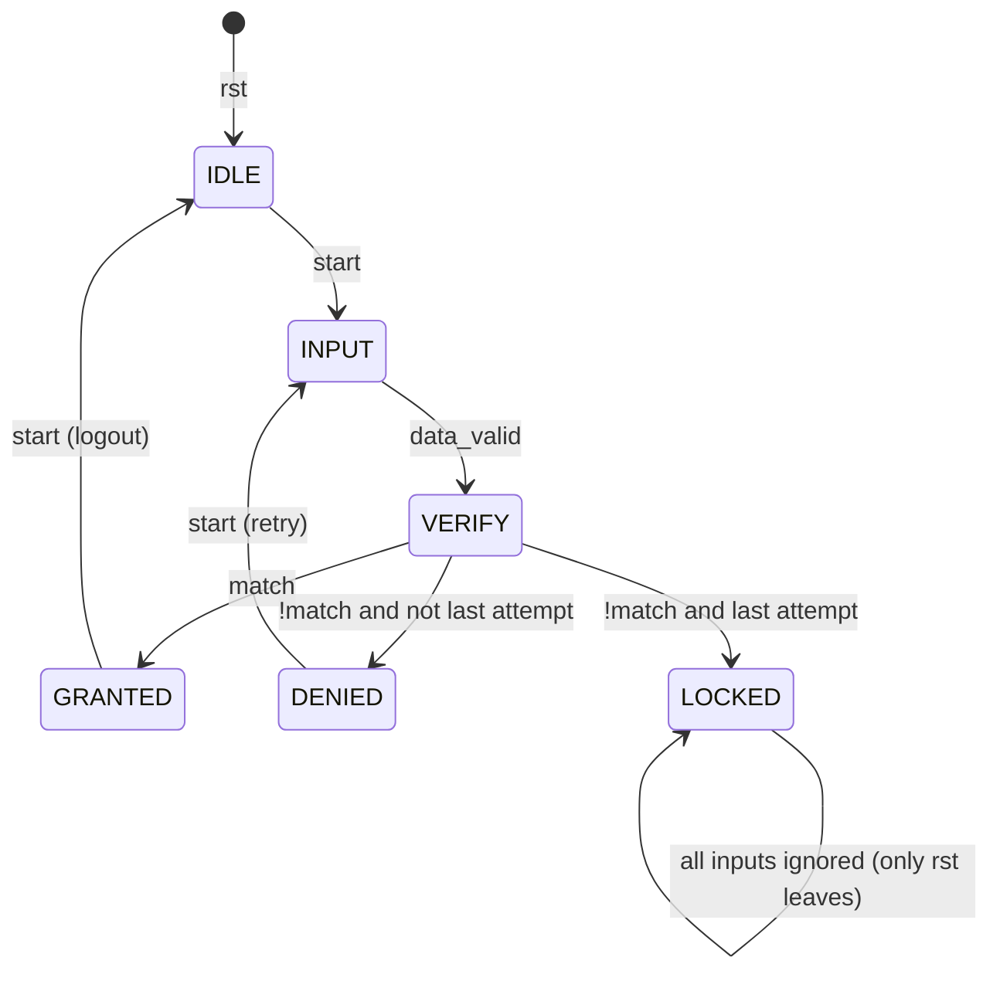

# Architecture

> Educational prototype. The 4-bit credential `1010` (0xA) is hardcoded for demonstration and is **not** production-grade password security.

## 1. Two independent implementations

| Part | What it is | How it is verified |
|------|-----------|--------------------|
| `rtl/*.v` | Synthesizable Verilog-2001 authentication controller | Icarus Verilog self-checking testbench; Yosys synthesis |
| `esp32/esp32_login.ino` | C++ software model of the same login behaviour, runs on the ESP32 | Serial Monitor demonstration |

**The ESP32 does not execute Verilog.** The two parts share behaviour (credential 0xA, 3 attempts, lockout, admin reset) but run separately. A future link between them would be the UART design in section 5.

## 2. Block diagram

```
 USER INPUT (Serial Monitor / simulated testbench stimuli)
        |
        v
 ESP32 EMBEDDED CONTROLLER  (software model)       [future: UART link]
        |                                                  |
        v                                                  v
 Authentication Interface  ----------------->  Verilog login_controller
                                               +-----------------------------+
                                               | data_reg (4 FF)             |
                                               |   |                         |
                                               |   v                         |
                                               | credential_checker --match--+--+
                                               |                             |  |
                                               | attempt_counter <-inc/clear-+  |
                                               |   | last_attempt            |  v
                                               |   +-----------------> authentication_fsm
                                               +-----------------------------+   |
                                                                  +--------------+--------------+
                                                                  v              v              v
                                                               GRANTED        DENIED          LOCKED
```

## 3. Verilog module hierarchy

```
login_controller            (top)
 |- credential_checker      combinational compare with CREDENTIAL (4'b1010)
 |- attempt_counter         2-bit saturating counter, MAX_ATTEMPTS = 3
 |- authentication_fsm      Moore FSM, 3-bit state register
```

### Top-level ports (`login_controller`)

| Port | Dir | Width | Description |
|------|-----|-------|-------------|
| clk | in | 1 | Clock |
| rst | in | 1 | Synchronous active-high reset (the "administrative reset") |
| start | in | 1 | Pulse: begin login / retry after denial / logout after grant |
| data_valid | in | 1 | Pulse: `data_in` holds an entered credential (used in INPUT state) |
| data_in | in | 4 | Entered credential |
| granted / denied / locked | out | 1 | One-hot status (Moore outputs) |
| attempts | out | 2 | Failed-attempt count (0..3) |
| state_out | out | 3 | Encoded state, for debug and testbench |

## 4. FSM

States: `IDLE=0, INPUT=1, VERIFY=2, GRANTED=3, DENIED=4, LOCKED=5`.



| From | Condition | To | Action |
|------|-----------|----|--------|
| IDLE | start | INPUT | - |
| INPUT | data_valid | VERIFY | capture `data_in` |
| VERIFY | match | GRANTED | clear attempt counter |
| VERIFY | !match and counter == MAX-1 | LOCKED | increment counter (reaches 3) |
| VERIFY | !match and counter < MAX-1 | DENIED | increment counter |
| GRANTED | start | IDLE | logout |
| DENIED | start | INPUT | retry |
| LOCKED | (anything except rst) | LOCKED | - |
| any | rst | IDLE | counter and data register cleared |

Design notes: all `always @(*)` blocks assign defaults first, so no latches are inferred (Yosys confirms). The `default:` branch of the next-state case returns an illegal state encoding (6, 7) to IDLE.

## 5. UART integration design (future ESP32 <-> FPGA)

> **Not implemented in the RTL.** The four required Verilog modules contain no UART. A real link would need a `uart_rx`, a `uart_tx` and a frame-parser module on the FPGA side, plus a board with 3.3 V I/O.

### 5.1 Physical layer

| Signal | ESP32 (UART2) | FPGA | Notes |
|--------|---------------|------|-------|
| ESP32 TX -> FPGA RX | GPIO17 | `uart_rx` pin | 3.3 V logic |
| ESP32 RX <- FPGA TX | GPIO16 | `uart_tx` pin | 3.3 V logic |
| GND | GND | GND | Common ground is mandatory |

Settings: 115200 baud, 8 data bits, no parity, 1 stop bit (8N1). Do not connect 5 V logic directly to ESP32 pins.

### 5.2 Message format (binary, fixed 4 bytes)

```
Request  : [SOF=0x7E] [CMD] [DATA] [CHK]
Response : [SOF=0x7E] [STATUS] [ATTEMPTS] [CHK]
CHK = CMD ^ DATA   (request)   |   STATUS ^ ATTEMPTS   (response)
```

| CMD | Meaning | DATA |
|-----|---------|------|
| 0x01 | LOGIN attempt | low nibble = credential |
| 0x02 | ADMIN RESET (drives `rst` for 2 cycles) | 0x5A (guard value) |
| 0x03 | STATUS query | 0x00 |

| STATUS | Meaning |
|--------|---------|
| 0x10 | GRANTED |
| 0x20 | DENIED |
| 0x30 | LOCKED |
| 0x00 | IDLE / other |
| 0xE0 | Bad frame / checksum error |

### 5.3 Examples

| Direction | Bytes | Meaning |
|-----------|-------|---------|
| ESP32 -> FPGA | `7E 01 0A 0B` | Login with 0xA |
| FPGA -> ESP32 | `7E 10 00 10` | GRANTED, 0 failed attempts |
| ESP32 -> FPGA | `7E 01 05 04` | Login with 0x5 |
| FPGA -> ESP32 | `7E 20 01 21` | DENIED, 1 failed attempt |
| FPGA -> ESP32 | `7E 30 03 33` | LOCKED, 3 failed attempts |
| ESP32 -> FPGA | `7E 02 5A 58` | Admin reset |

The FPGA-side parser would turn a LOGIN frame into: pulse `start`, then pulse `data_valid` with `data_in`, then wait two clocks and read the state.

### 5.4 ESP32 UART example (Arduino framework, not part of the standalone demo)

```cpp
// uart_fpga_example.ino - sends one LOGIN frame and reads the response.
// Only useful once an FPGA implements the protocol above.
#define FPGA_RX_PIN 16   // ESP32 RX2 <- FPGA TX
#define FPGA_TX_PIN 17   // ESP32 TX2 -> FPGA RX

bool sendLogin(uint8_t nibble, uint8_t &status, uint8_t &attempts) {
  uint8_t cmd = 0x01, data = nibble & 0x0F;
  uint8_t frame[4] = {0x7E, cmd, data, (uint8_t)(cmd ^ data)};
  Serial2.write(frame, 4);

  uint8_t rx[4]; size_t n = 0; unsigned long t0 = millis();
  while (n < 4 && millis() - t0 < 200) {
    if (Serial2.available()) rx[n++] = Serial2.read();
  }
  if (n < 4 || rx[0] != 0x7E || (rx[1] ^ rx[2]) != rx[3]) return false; // timeout/bad frame
  status = rx[1]; attempts = rx[2];
  return true;
}

void setup() {
  Serial.begin(115200);
  Serial2.begin(115200, SERIAL_8N1, FPGA_RX_PIN, FPGA_TX_PIN);
}

void loop() {
  uint8_t st, att;
  if (sendLogin(0xA, st, att)) Serial.printf("status=0x%02X attempts=%u\n", st, att);
  else Serial.println("No valid response from FPGA");
  delay(3000);
}
```

### 5.5 Limitations

- Plain-text-equivalent credential on the wire: no encryption, no authentication of the link, trivially replayable.
- The XOR checksum catches only simple corruption.
- No flow control or retransmission; frames use a 200 ms timeout.
- The Verilog design needs a clock-domain-aware UART (oversampling RX, baud generator) that is not included.
- Voltage levels, grounding and wiring must be checked per board.

## 6. ESP32 hardware connections (all optional)

The sketch runs with nothing attached except USB. Set `USE_INDICATORS` to 0 if nothing is wired.

| Component | ESP32 pin | Series part | Other leg |
|-----------|-----------|-------------|-----------|
| Green LED (success) | GPIO25 -> anode | 220-330 ohm resistor | LED cathode to GND |
| Red LED (failure / lockout) | GPIO26 -> anode | 220-330 ohm resistor | LED cathode to GND |
| Active buzzer, 3.3 V rated | GPIO27 -> (+) | none if rated under about 10 mA, else use a transistor | (-) to GND |

GPIO25, 26 and 27 are ordinary output-capable pins that are not strapping pins on common ESP32 DevKit boards. Keep each GPIO to roughly 10 mA (LED at 3.3 V with 330 ohm is about 4 mA). Passive buzzers need a PWM tone and are not supported by this sketch.

## 7. Behaviour differences, RTL vs ESP32

| Aspect | Verilog RTL | ESP32 sketch |
|--------|-------------|--------------|
| Credential width | 4 bits (1010) | 1-4 hex characters; value must equal 0x000A |
| Invalid input | Not possible (4-bit bus) | Rejected without counting an attempt |
| Admin reset | `rst` pin | `#RESET` then `CONFIRM` within 10 s |
| DENIED state | Explicit state, waits for `start` | Momentary; the prompt returns immediately |
