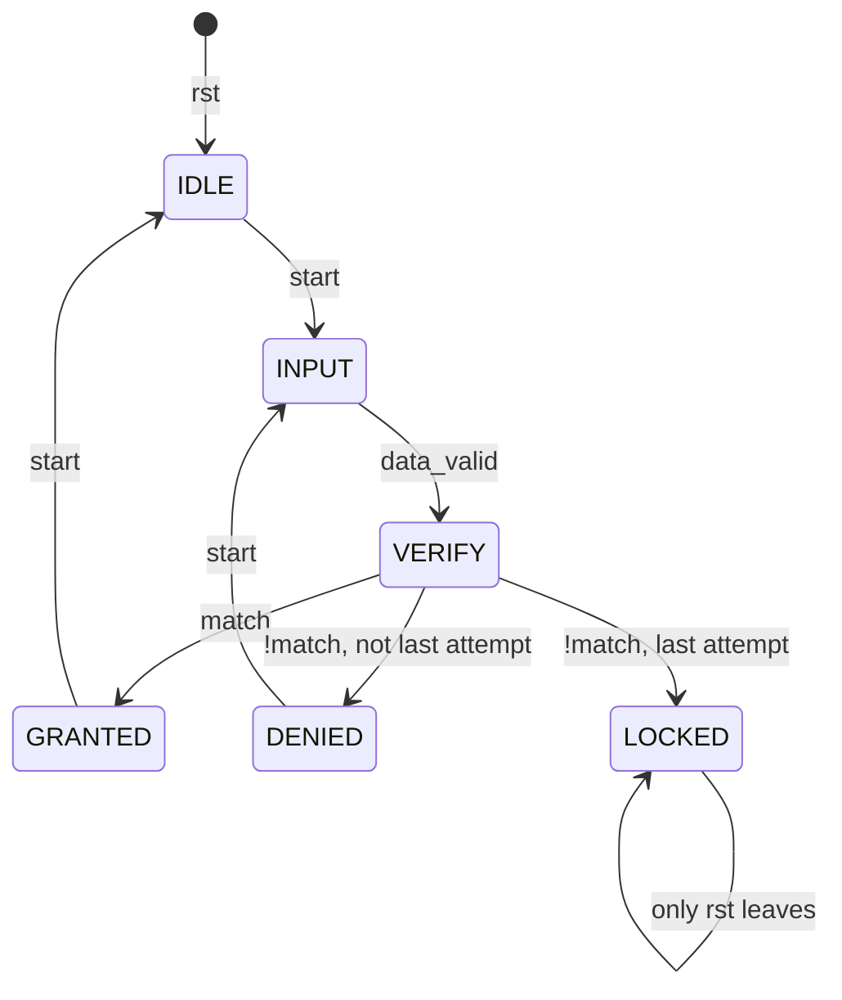

# Design and Implementation of a Hardware-Assisted Login Authentication System Using Verilog HDL and ESP32

*Course: VLSI to Embedded Systems | Educational prototype*

## 1. Abstract
This project designs a login authentication controller as synthesizable Verilog-2001 and demonstrates the same behaviour on an ESP32 through a serial interface. The RTL contains a six-state Moore finite state machine, a combinational credential checker and a saturating failed-attempt counter. It accepts a 4-bit demonstration credential (1010), locks after three consecutive failures and is released only by reset. The RTL is verified with a self-checking Icarus Verilog testbench (16 checks, all passing) and synthesized with Yosys. The ESP32 firmware is an independent software model of the same behaviour; the ESP32 does not execute Verilog. A UART protocol for a future ESP32-to-FPGA link is specified but not implemented. The system is a learning prototype, not a secure authentication product.

## 2. Introduction
Access control is usually implemented in software, but dedicated hardware state machines are used where deterministic behaviour, small area or isolation from a main processor matter. This project examines the hardware/software split by implementing one login policy in two ways: as RTL for an FPGA or ASIC flow, and as firmware on a microcontroller.

## 3. Problem Statement
Software-only login logic shares a processor with other code and can be bypassed by software faults. The goal is to express the core login policy (credential comparison, attempt limiting, lockout) as a small, verifiable hardware design, and to show how an embedded controller could present and interact with it.

## 4. Objectives
1. Design a synthesizable FSM-based authentication controller in Verilog-2001.
2. Enforce a three-attempt limit with lockout and reset recovery.
3. Verify the design with a self-checking testbench in Icarus Verilog.
4. Synthesize the design with Yosys and report real statistics.
5. Implement a runnable ESP32 serial login demonstration.
6. Specify a UART protocol for future ESP32/FPGA integration.

## 5. Existing System
Typical embedded logins compare a typed secret in firmware, keep an attempt counter in RAM and apply a software lockout. These are flexible, but state lives in modifiable memory and the check competes with all other firmware. Production systems add hashing, salting, rate limiting with delays, secure elements and tamper protection, none of which this prototype has.

## 6. Proposed System
A split design: an ESP32 acts as the user-facing controller (input, messages, indicators), while a Verilog controller embodies the authentication policy. For the one-day prototype the two are demonstrated separately: the RTL in simulation, the ESP32 as a standalone software model with identical policy.

## 7. Block Diagram
```
USER INPUT -> ESP32 EMBEDDED CONTROLLER -> Authentication Interface -> Verilog Authentication Controller
                                                                           |-> Credential Checker --+
                                                                           |-> Attempt Counter -----+-> Access Control -> GRANTED / DENIED
```
The detailed diagram is in `docs/architecture.md`.

## 8. Architecture Explanation
`login_controller` instantiates three blocks. A 4-bit data register captures the entered credential when the FSM asserts `capture`. `credential_checker` compares the register with the parameter `CREDENTIAL` (4'b1010). `attempt_counter` is a 2-bit counter that saturates at `MAX_ATTEMPTS` (3) and exposes `last_attempt` (count == 2). The FSM combines `match` and `last_attempt` in the VERIFY state to choose GRANTED, DENIED or LOCKED, and issues `inc_attempt` or `clr_attempt` to the counter. Outputs `granted`, `denied` and `locked` are decoded from the state register (Moore).

## 9. FSM State Diagram


## 10. Verilog Module Descriptions
| Module | File | Purpose |
|--------|------|---------|
| credential_checker | rtl/credential_checker.v | Parameterised equality comparator |
| attempt_counter | rtl/attempt_counter.v | Saturating failure counter, synchronous reset, clear has priority over increment |
| authentication_fsm | rtl/authentication_fsm.v | Six-state Moore FSM, separate state register, next-state and output blocks, defaults to avoid latches |
| login_controller | rtl/login_controller.v | Top level; data register and wiring of the three blocks |

## 11. ESP32 Implementation
`esp32/esp32_login.ino` (Arduino-ESP32 framework) reads the Serial Monitor without blocking, using a character buffer filled in `loop()`. It accepts one to four hexadecimal characters, compares the value to 0xA, counts failures, locks after three and prints a status message for every event. Invalid characters are rejected without consuming an attempt. An administrative reset requires two steps (`#RESET`, then `CONFIRM` within 10 seconds). Optional green LED, red LED and active buzzer indicators are driven from GPIO25, 26 and 27 using `millis()` timing, with no `delay()` in the logic path. The firmware was checked by compiling it on a host PC with a small Arduino shim and running a scripted session; it was not flashed to physical hardware in the preparation of this report.

## 12. Simulation Methodology
The testbench (`testbench/tb_login_controller.v`) instantiates `login_controller`, generates a 100 MHz clock, drives inputs 1 ns after each rising edge and samples outputs after the next edge. Helper tasks (`do_reset`, `press_start`, `enter`) make each scenario readable, and a `check` task prints PASS or FAIL per test and counts results. A watchdog ends a hung simulation. Commands:
```
iverilog -g2012 -o login_sim rtl/*.v testbench/*.v
vvp login_sim
```

## 13. Test Cases and Results
Results from running the commands above (Icarus Verilog):

| ID | Scenario | Result |
|----|----------|--------|
| T1 | Reset gives IDLE, attempts 0 | PASS |
| T2a-d | Start, correct credential, GRANTED, attempts 0, logout | PASS |
| T3 | Wrong credential gives DENIED, attempts 1 | PASS |
| T4a-b | Success after a failure clears the counter | PASS |
| T5a-c | Three failures give DENIED, DENIED, LOCKED (attempts 3) | PASS |
| T6a-b | While LOCKED, start and correct credential are ignored | PASS |
| T7 | Reset clears lockout and counter | PASS |
| T8a-b | Correct login after reset; counter restarts from 0 | PASS |

Summary: 16 passed, 0 failed, OVERALL: PASS.

## 14. Synthesis Methodology
Script: `synthesis/yosys_commands.txt`, run with `yosys -s synthesis/yosys_commands.txt`. Steps: read Verilog, `hierarchy -check -top login_controller`, `proc`, `opt`, `fsm`, `synth`, `check`, `stat`. Results obtained with Yosys 0.33 (generic gate library, no technology mapping):

| Item | Count |
|------|-------|
| Flip-flops (`$_SDFFE_PP0P_`, reset and enable merged) | 9 (3 state + 4 data register + 2 counter) |
| Combinational gates | 38 (17 ANDNOT, 6 OR, 5 ORNOT, 3 AND, 3 NOR, 2 NOT, 1 NAND, 1 XOR) |
| Total cells | 47 |
| Latches inferred | 0 |

These are generic-gate counts. They are not silicon area, power or timing, and other Yosys versions or settings may give different numbers. Timing: all paths are short (state/counter/data register to next-state logic) and the design has no multi-cycle paths; real maximum frequency requires a target library or FPGA tool flow with timing analysis (for example `abc -liberty` plus static timing, or the vendor's place-and-route). Power cannot be estimated from this flow.

## 15. Applications
Teaching FSM design and the hardware/software boundary; door-lock or panel-lock concepts; attempt-limiting blocks inside larger FPGA designs; a base for UART-controlled access modules.

## 16. Limitations
- Hardcoded 4-bit credential (16 possibilities) is trivially guessable; this is not secure.
- Lockout is removed by reset only; there is no authenticated admin path in the RTL, and the ESP32 `CONFIRM` step is a safety check, not strong authentication.
- Failed-attempt state is not stored in non-volatile memory; power cycling clears the lockout.
- No input debouncing, UART or rate limiting in RTL.
- The ESP32 and Verilog implementations are not connected in the delivered prototype.
- Synthesis figures are generic and unvalidated on hardware; the ESP32 sketch was not run on a physical board during preparation.

## 17. Future Enhancements
Implement UART RX/TX and the frame parser in Verilog and test on an FPGA board; store a salted hash instead of a plain credential; non-volatile lockout state; lockout timer with back-off; keypad input; authenticated administrative unlock; formal verification of the FSM (for example with SymbiYosys).

## 18. Conclusion
A complete login-control policy was captured as a small synthesizable FSM design, verified by a self-checking testbench, synthesized to 9 flip-flops and 38 generic gates, and mirrored by an independent ESP32 firmware demonstration. The work shows the division between hardware policy and embedded presentation, while being clear that the prototype is educational and the ESP32 does not run the Verilog.
